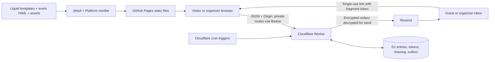

# Architecture and source map

[Documentation index](../README.md) · Contract details: [API](API.md) · Behavior: [Drawing](DRAWING.md)

## Runtime boundaries

Pages contains no database, secrets or server-side application runtime. The Worker owns validation, eligibility, permissions and drawing state. Hiding a button is not authorization. Pages and the Worker have separate deployment lifecycles.

## Where to make changes

| Area | Source |
| --- | --- |
| Public facts, labels, navigation, FAQ | [`_data/event.yml`](../_data/event.yml) |
| Hosting, API URL, indexing, cache version | [`_config.yml`](../_config.yml) |
| Homepage structure | [`index.html`](../index.html) |
| Shared page chrome and metadata | [`_layouts/default.html`](../_layouts/default.html), [`_includes/head.html`](../_includes/head.html) |
| Entry form and shared hours | [`_includes/entry-form.html`](../_includes/entry-form.html), [`_includes/hot-spot-hours.html`](../_includes/hot-spot-hours.html) |
| Visual system, responsive layout, animation CSS | [`assets/css/main.scss`](../assets/css/main.scss) |
| Countdown, animation lifecycle, cursor, video | [`assets/js/main.js`](../assets/js/main.js) |
| Public registration | [`assets/js/entry.js`](../assets/js/entry.js) |
| Private entry page | [`entry.html`](../entry.html), [`assets/js/manage-entry.js`](../assets/js/manage-entry.js) |
| Organizer UI | [`admin.html`](../admin.html), [`assets/js/admin.js`](../assets/js/admin.js) |
| Browser API wrapper, token handling, status helpers | [`assets/js/api.js`](../assets/js/api.js) |
| Public rules and privacy notice | [`drawing-rules.html`](../drawing-rules.html), [`privacy.html`](../privacy.html) |
| Canonical illustration | [`assets/art/chile-sign.svg`](../assets/art/chile-sign.svg) |
| Asset/font/calendar generation | [`scripts/prepare-assets.mjs`](../scripts/prepare-assets.mjs) |
| Social image generation | [`scripts/render-social.mjs`](../scripts/render-social.mjs) |
| Local static server | [`scripts/serve.mjs`](../scripts/serve.mjs) |
| Request handling, auth and state transitions | [`api/src/worker.js`](../api/src/worker.js) |
| Random order and capacity calculation | [`api/src/drawing.js`](../api/src/drawing.js) |
| Outbox encryption, dispatch, mail copy, reports | [`api/src/mail.js`](../api/src/mail.js) |
| Database schema | [`api/migrations/0001_drawing.sql`](../api/migrations/0001_drawing.sql) |
| Worker infrastructure | [`api/wrangler.toml`](../api/wrangler.toml) |
| CI and Pages release | [`.github/workflows/pages.yml`](../.github/workflows/pages.yml) |

## Shared Platform and generated files

The submodule at `shared/dust-wave-platform` is pinned by Git and [platform.json](../platform.json). Current consumers use:

| Package | Reuse |
| --- | --- |
| `site-shell` | Browser navigation |
| `design-core` | Layout/design mixins |
| `build-core` | CSS/JS asset minification |
| `test-core` | Consumer-pin and browser rendering assertions |
| `admin-shell` | Browser API client |
| `worker-core` | Email normalization, tokens/hashes, bounded request/response parsing, email preparation, outbox IDs/retries and Resend failure classification |

`npm run build` first copies font files/licenses and the shared navigation/API modules, then generates `event.ics`, builds Jekyll into `_site`, and minifies assets there. These copied outputs are ignored by Git. The social PNG is a separate, explicit render step and is committed when updated. Edit the source SVG, not the generated image, for art changes.

The site has no runtime React/Vue framework. Keep reusable primitives in Platform and event-specific behavior here. Store RSVP/cart modules are not connected to the drawing.

## Database model

The schema supports **one event and one drawing**. SQL timestamps are epoch milliseconds unless a field explicitly stores a date string.

| Table | Purpose and invariants |
| --- | --- |
| `settings` | Singleton `id=1`; registration flag, capacity 1–2000 and revision |
| `entries` | UUID, unique normalized email, name, group size, consent version, creation/update/verification/deletion timestamps |
| `tokens` | SHA-256 hashes of link/session tokens, type, subject, expiration and single-use consumption state |
| `rate_limits` | Hashed identity/time buckets and counts; no raw IP/email key |
| `draw_preview` | Singleton immutable UUID, capacity, captured revision and ranked results JSON |
| `drawing` | Singleton committed preview reference and optional publication time |
| `results` | One rank/status per entry; foreign key to entries |
| `outbox` | Deduplicated mail jobs, encrypted payload or deferred winner ID, attempts, leases, provider receipt and bounded error evidence |
| `audit` | Admin action requests, actor and limited identifiers/settings; not a copy of entry records |

Entry insert/delete and changes to size/verification advance the settings revision. Preparation records it, and commit checks it. Related writes use D1 batches so token creation/mail enqueue and result publication/winner enqueue stay together. Audit actions ending in `_requested` describe requests; inspect the resulting state before treating them as completed transitions.

See [Drawing](DRAWING.md) for post-preparation erasure: rank/size remain while personal details are anonymized. No automatic global retention purge exists.

## Authentication and privacy

Links carry random tokens in URL fragments (`#token=…`). Browser code removes the fragment before exchanging the token; the server stores token hashes. Successful exchange creates a role-specific Bearer session saved in `sessionStorage`, never a cookie or persistent `localStorage`. UI sign-out clears the browser copy; it does not revoke the server token before expiry. Do not introduce third-party scripts on private token pages.

Allowed origins are exact origins, not URL prefixes. Private GETs also require an allowed `Origin` header. Bearer auth and the admin allowlist protect private records; CORS alone does not. All projects on `https://aindaco1.github.io` share an origin, so the project path is not a security boundary.

Entry names/status text are rendered with `textContent`; CSV cells neutralize leading spreadsheet formulas. The API bounds JSON bodies and returns private/no-store responses with noindex and no-referrer headers. Mail payloads use AES-GCM with the job ID authenticated as associated data. Encryption protects queued payloads, not every database column: entry names/emails are available to authorized administration.

No payment/card information is collected. Fonts/art are self-hosted; the video player is click-to-load; there are no advertising or analytics cookies. GitHub, Cloudflare and Resend still process data needed to provide hosting/API/email services. The public [privacy notice](../privacy.html) must stay aligned with implementation.

## Test boundaries

[`api/test/helpers.js`](../api/test/helpers.js) creates an in-memory SQLite database from the migration and injects a fake clock/mail transport into `createWorker`. It emulates the D1 methods used here; it is not a remote D1 environment. Browser tests intercept API calls, so their success does not establish production persistence, email delivery or organizer authentication.

Use [Development](DEVELOPMENT.md) for commands and [Operations](OPERATIONS.md) to distinguish local, CI and production verification.
