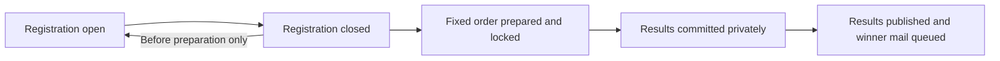

# Free group drawing

[Documentation index](../README.md) · [API reference](API.md) · [Email and deployment operations](OPERATIONS.md)

This guide describes the implemented behavior. The public-facing version is [drawing-rules.html](../drawing-rules.html). Entry and selected admission are free; an entry is not a confirmed reservation. The earlier paid-chance/cart proposal is superseded.

## Guest lifecycle

1. Submit a name, email, group size including the entrant, and agreement to the rules. The size must be an integer from 1 through 2,000.
2. Confirm the email through the single-use link. Only verified entries participate. Email is trimmed/lowercased and unique; submitting an existing email sends access to its owner without overwriting their group.
3. Use the private entry page to change name/size while registration is open. Changing the email address is not supported by this form/API.
4. After registration closes, no new entries, first-time verifications or group edits are accepted. Already-verified owners can still request a link to see their status.
5. After publication, selected groups receive an email. Every verified entrant can view their own selected/waitlisted status privately. Unselected groups do not receive a separate results email in the current implementation.

One entry per email is an ownership/deduplication rule, not proof of one real person or household. There is no stronger identity or cross-address duplicate detection. Link lifetime and rate limits are in [API](API.md).

## Selection algorithm

[`api/src/drawing.js`](../api/src/drawing.js) uses Fisher–Yates with cryptographic random values and rejection sampling to avoid modulo bias. Each verified group receives one position in the random order regardless of size.

Starting at rank 1, select each whole group while it fits. **At the first group that would exceed capacity, stop.** That group and every later group are waitlisted, even if a later smaller group would fit. Capacity is at most 2,000. No group is split and there is no automatic promotion.

Example with capacity 10:

| Rank | Group size | Result | Guests selected so far |
| --- | --- | --- | --- |
| 1 | 4 | Selected | 4 |
| 2 | 5 | Selected | 9 |
| 3 | 2 | Waitlisted; selection stops | 9 |
| 4 | 1 | Waitlisted; cannot skip ahead | 9 |

One place remains unused. Every group has an equal chance at each rank, but unequal sizes can have different final admission probabilities. Do not describe the algorithm as equal odds of admission per group or as maximizing occupancy.

## Organizer workflow

The [organizer desk](https://aindaco1.github.io/nob-hill-chile-drop/admin/) uses the email allowlist in Worker configuration. Currently the organizer and report recipient are `alonso@dustwave.xyz`. Requesting a login link sends email; do not use it for unattended smoke tests.

| Step | Action and consequence |
| --- | --- |
| Review entries | Sign in, inspect verified group/guest totals, paginate entries and review email queue counts. CSV export includes personal data. |
| Set capacity and close entry | Save the intended capacity and turn off registration. This prevents new registration, edits and first verification. You may reopen **only before preparation**. |
| Prepare drawing | Confirm the locking notice, then prepare. This immediately saves the random order and capacity and prevents reopening/capacity changes. It is not a disposable preview. |
| Review fixed result | Review selected/waitlisted totals and unused capacity. Repeating preparation returns the same saved order. The API preview response contains the private rank details; the UI shows totals. |
| Commit drawing | Saves results from that exact prepared preview; guests still cannot see them and winner notifications have not been queued. Repeating the same commit is idempotent. |
| Publish | Confirm the publication notice. This exposes private results to entrants and public counts, and atomically queues selected-group notifications. It does not wait for delivery. Repeating publish does not queue duplicates. |
| Follow through | Check queue/provider status and provide the separately approved arrival/check-in instructions. The application does not issue admission QR codes or check people in. |

Prepare, commit and publish are separate deliberate steps. Nothing schedules or automatically runs the drawing. The configured cron only dispatches mail, cleans expired auth/rate-limit records and queues weekly reports. Closing registration does not cancel a valid already-verified owner's access.

There is no reset/reroll endpoint. Do not delete the preview or change database rows to get a different outcome. If an operational issue arises after preparation, preserve the fixed order and seek an explicit organizer decision before changing its treatment.

## State and concurrency

Preparation captures a settings/entry revision. The database guards against preparing from a stale revision, and commit requires that same revision with registration closed. Result insertion and publication mail enqueue use batches and unique IDs. Repeating calls after an uncertain HTTP response must recover the same state, not generate a new order or a new winner-mail key.

Public results contain only selected group/guest counts. Private entry status hides selected/waitlisted until publication. Admin records and CSV may show committed results before publication; treat them as private.

## Privacy requests and exports

Verify the requester's authority to remove an entry before using the admin-only deletion API. The organizer UI currently has no deletion control; [API](API.md) documents `DELETE /api/admin/entries/:id` for an authorized support action.

- Before preparation, erasure deletes the entry, removes its tokens and suppresses its queued mail.
- After preparation, erasure replaces personal details with an anonymous placeholder while preserving group size and the fixed rank/result. Tokens are removed and pending mail is suppressed. Capacity is not automatically reallocated.
- Sent jobs retain their sent state but lose payload; other recipient-linked jobs are suppressed and cleared. An already accepted or in-flight provider request cannot be recalled by database erasure.
- CSV exports, provider-held records, backups and inbox copies require separate handling. Do not claim a database operation deleted all external copies.

CSV export includes IDs, name/email, group size, creation/verification timestamps, result and rank. Timestamp columns are raw epoch milliseconds; entries are ordered by creation time then ID. Formula-like leading cell content is escaped. Store exports privately; do not commit them, add them to Pages or attach them to public issues.

## Weekly activity

Monday `16:00 UTC` reports go to the configured `REPORT_EMAIL` (9 a.m. MST / 10 a.m. MDT). They contain new/total/verified group and guest counts, registration/capacity and outbox status counts. They contain no guest list, sales or payment amounts. Records retained after anonymization remain in totals.

Report creation is deduplicated by UTC date. There is no automatic end date for reports; remove the weekly trigger when the organizer ends the campaign, retaining the mail-dispatch trigger while queued work remains. `sent` means the provider accepted the message, not that it arrived in an inbox. See [Operations](OPERATIONS.md) for recovery and scheduling details.
